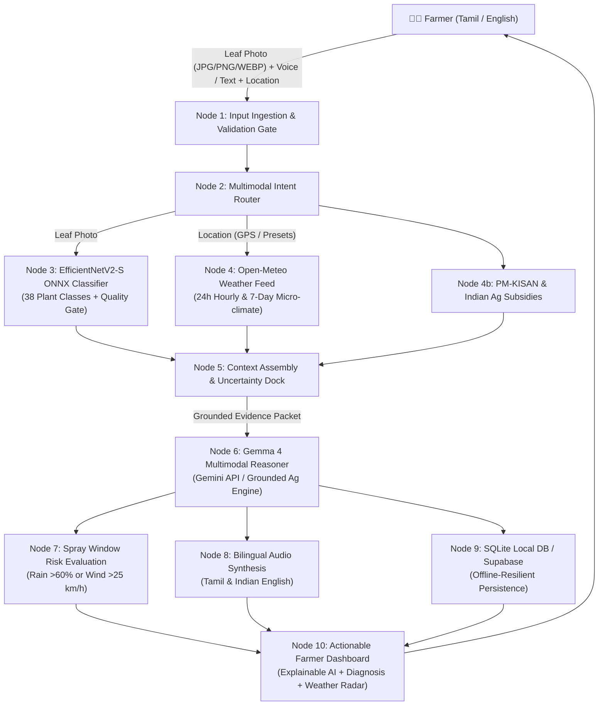

# 🌾 AgroNex AI — Multimodal Agricultural Copilot for Farmers

[](LICENSE)
[](https://python.org)
[](https://fastapi.tiangolo.com)
[](https://react.dev)
[](https://vitejs.dev)
[](https://ai.google.dev)
[](https://onnxruntime.ai)
[](https://open-meteo.com)
[](https://hacktoberfest.com)

> **AgroNex AI** is an open-source multimodal agricultural assistant designed for smallholder and commercial farmers in India. Built for **MLH Hacktoberfest 2026** and competing for **Best Open-Source AI Project** and **Best Use of Gemma 4**, AgroNex unites genuine open-source computer vision leaf pathology, real-time Open-Meteo weather risk intelligence, and Gemma 4 multimodal reasoning into a bilingual (Tamil & English), safety-governed agricultural workflow.

---

## 🌟 Hackathon Alignment & Highlights

### 1. Best Open-Source AI Project — MLH Hacktoberfest 2026
- **Complete End-to-End Open-Source Pipeline**: Combines an open-source EfficientNetV2-S ONNX neural classifier trained on the PlantVillage dataset (38 crop disease classes, CC-BY 4.0) with an open weather API (Open-Meteo, ODbL).
- **Public-Repository-Ready**: Licensed under the **MIT License**, with zero-setup local SQLite persistence, modular FastAPI microservices, and clean React 19 frontend.
- **Explainable AI (XAI)**: Demystifies predictions by presenting what the model detected, which visual symptoms (chlorosis, target rings, necrotic margins) were identified, how weather influences disease progression, why each recommendation is made, and when to seek certified Krishi Vigyan Kendra (KVK) expertise.

### 2. Best Use of Gemma 4 — Multimodal AI & Focused Assistance
- **Multimodal Leaf Diagnosis**: Seamlessly supports image-plus-text queries using Gemma 4 via the Gemini API. Farmers can submit leaf photographs (JPEG, PNG, WebP) along with natural language questions.
- **Bilingual Tamil (தமிழ்) & English Support**: Generates authentic agricultural advice in both English and Tamil, using natural vernacular terms familiar to Indian farming communities.
- **Structured Explanations**: Produces machine-validated JSON responses comprising:
  - `observations`: Clear visible leaf symptoms.
  - `possible_causes`: Primary fungal, bacterial, viral, or abiotic stress factors.
  - `recommended_next_steps`: Cultural sanitation, bio-control remedies (e.g., Neem cake, Trichoderma viride), and water management.
  - `weather_risk_factor`: How ambient humidity, temperature, and rain affect pathogen spread.
  - `why_recommendations`: Scientific rationale for each recommended intervention.
  - `uncertainty_warnings`: Strict safety warnings distinguishing AI hypothesis from certified lab diagnosis.
  - `expert_consultation_triggers`: Explicit criteria triggering extension officer consultation.
- **Agricultural Safety Guardrails**: Never fabricates disease certainty; never invents off-label or unsafe chemical pesticide dosages; always enforces spray window constraints.

---

## 🧭 System Architecture

AgroNex transforms passive machine learning into an active **evidence-grounded decision workflow**:



---

## 🚀 Core Features

### 1. Crop Intelligence Engine (Module 1)
- **Multi-Format Ingestion**: Supports authentic **JPEG**, **PNG**, and **WebP** leaf images up to **10 MB**. Enforces safe magic-byte header validation and PIL integrity checks to safely reject corrupted, empty, or disguised non-image files.
- **Image Quality Gate (`ImageQualityService`)**: Reusable optical and botanical inspection evaluating:
  - Minimum resolution ($w, h \ge 100$ px)
  - Illumination extremes: underexposure / darkness (mean luminance $< 40$) and overexposure glare ($> 25\%$ clipped pixels)
  - Sharpness and focus: 2D discrete Laplacian variance ($< 60.0$)
  - Botanical texture & foliage presence: evaluates surface structure and Excess Green Index ($2G - R - B$) without hard-rejecting leaves with severe necrosis, chlorosis, or anthocyanin pigments
  - Actionable photography tips in English and Tamil
- **Open-Source EfficientNetV2-S ONNX Engine (`OnnxInferenceService`)**:
  - Reusable cached `ort.InferenceSession` with thread pool tuning for low-latency ($< 35$ ms) serving
  - Verified preprocessing: NCHW `(1, 3, 224, 224)` float32 normalized with ImageNet mean `[0.485, 0.456, 0.406]` and std `[0.229, 0.224, 0.225]`
  - Supports both direct bilinear resize and aspect-ratio preserving letterbox padding
  - Automatic EXIF orientation transpose and alpha-channel compositing over neutral canvas `(240, 240, 240)`
  - Full 38-class softmax output derived from raw logits with top-5 ranked predictions
  - Classification ambiguity detection (flags `is_ambiguous = True` when top-1 vs. top-2 margin $< 0.15$)
- **Uncertainty & Inconclusive Policy**:
  - Distinguishes heuristic model similarity scores from calibrated clinical probabilities
  - Configurable cutoff threshold via `UNCERTAINTY_THRESHOLD` (default: 60%)
  - Overall inconclusive state triggered on image quality degradation, model confidence $< 60\%$, or close ambiguous classification
  - Clear guidance to retake photo with indirect sunlight, steady focus, and neutral backgrounds
- **Backend Contract**:
  - Documented contract providing `analysis_id`, `predicted_class`, `display_name`, `model_score`, `confidence_interpretation`, `top_predictions`, `quality_assessment`, `inconclusive`, `photography_tips`, `model_version`, and `processing_time_ms`, fully synchronized with legacy fields (`crop`, `condition`, `confidence`, `status`, `is_inconclusive`).

### 2. Gemma Multimodal Copilot (Module 2)
- **Model and API Verification**:
  - Live Gemini API integration configured for candidate models: `gemini-2.5-flash`, `gemma-4`, `gemma-3-27b-it`, and `gemini-1.5-flash`.
  - Transparent diagnostic endpoint: `GET /api/assistant/model-info` reports real-time endpoint availability, active model identifier, API credential presence, candidate model fallbacks, and supported languages.
  - Zero model spoofing: Never falsely claims live Gemma 4 was used when offline or running on the grounding fallback engine (`is_fallback` and `model_used` explicitly declare active engine).
- **Agricultural Explanation Workflow**:
  - Seamlessly combines leaf photo evidence (JPEG, PNG, WebP), Module 1 neural classifier prediction (`model_score`, `is_inconclusive`, `quality_status`), Module 3 Open-Meteo micro-climate metrics with retrieval timestamps, and farmer inquiries.
  - Generates machine-validated structured output with all 10 Module 2 fields:
    1. `summary`: Concise, farmer-friendly overview of foliar condition.
    2. `observed_symptoms`: Distinct physical observations visible on the leaf surface.
    3. `possible_causes`: Primary biotic pathogens (fungal, bacterial, viral) or abiotic stress factors.
    4. `alternative_explanations`: Top differential diagnoses to prevent premature diagnostic closure.
    5. `model_prediction_context`: Explicit statement of computer vision similarity score and uncertainty state.
    6. `weather_influence`: Grounded analysis of ambient humidity, temperature, and rain probability on pathogen sporulation without fabricated measurements.
    7. `recommended_next_steps`: Prioritized, crop-appropriate integrated pest management (IPM) actions.
    8. `prevention_guidance`: Preventative agronomic practices (crop rotation, spacing, drainage, clean seed).
    9. `uncertainty_and_limitations`: Explicit caution distinguishing heuristic AI image classification from certified laboratory testing.
    10. `kvk_consultation_guidance`: Precise thresholds and directives for in-person consultation with local Krishi Vigyan Kendra (KVK) agronomists.
  - Retains full backward compatibility with legacy aliases (`observations`, `weather_risk_factor`, `why_recommendations`, `uncertainty_warnings`, `expert_consultation_triggers`, `disease_name`, `symptoms`, `recommendations`, `preventive_measures`).
- **Evidence & Agricultural Safety Guardrails**:
  - **Inconclusive & Low-Confidence Protection**: When confidence is below 60% or quality checks flag blur/glare/low-light, the copilot strictly forbids chemical spraying and advises capturing a sharper photo in indirect daylight.
  - **Dosage Safety**: Avoids unsupported pesticide dosages and unverified chemical mixtures; prioritizes non-chemical sanitation and organic bio-protectants (Neem oil, Trichoderma viride).
  - **Missing Evidence Handling**: When weather or location data is absent, states that readings were not provided rather than inventing sensor values.
- **Bilingual Chat (English & Tamil)**:
  - Natural Tamil (தமிழ்) and English support with persistent conversational context across multi-turn exchanges.
  - Indian farming vernacular: பயிர் (crop), இலைக்கருகல் (blight), புள்ளி நோய் (leaf spot), வேப்ப எண்ணெய் (neem oil), இயற்கை உரம் (organic manure), KVK (வேளாண் அறிவியல் நிலையம்).
  - Standardized quick prompts:
    - *"What symptoms did the model detect?"* / *"மாதிரி என்ன அறிகுறிகளைக் கண்டறிந்தது?"*
    - *"What should I check before treating this plant?"* / *"பயிருக்கு சிகிச்சையளிக்கும் முன் நான் எதைச் சரிபார்க்க வேண்டும்?"*
    - *"Explain this result in Tamil."* / *"இந்த முடிவை தமிழில் விளக்குங்கள்."*
    - *"How might the upcoming weather affect this crop?"* / *"வரவிருக்கும் வானிலை இந்த பயிரை எவ்வாறு பாதிக்கும்?"*
    - *"When should I consult a KVK expert?"* / *"நான் எப்போது KVK நிபுணரை அணுக வேண்டும்?"*
- **Multimodal Assistant Page Integration (`/assistant`)**:
  - Full-featured multimodal UI supporting text queries, leaf photo uploads, follow-up questions, speech recording, and accessible 10-field structured explanation cards.
- **Voice Features & Quota Resilience**:
  - Tamil and English speech-to-text (STT) and text-to-speech (TTS) powered by Sarvam AI (`saaras:v2` / `bulbul:v1`).
  - Graceful fallback when audio quotas are exhausted or mic permissions are unavailable without crashing chat generation.
- **Deterministic Agricultural Grounding Engine**:
  - Peer-reviewed pathology knowledge engine covering all 38 PlantVillage crop-condition classes, ensuring safe, structured guidance even in completely offline rural deployments.

### 3. Weather Intelligence and Farm Safety Engine (Module 3)
- **Open-Meteo Forecast Integration**:
  - Direct integration with the Open-Meteo numerical weather forecast API (`https://api.open-meteo.com/v1/forecast`).
  - Provides a 24-hour hourly forecast and a 7-day regional outlook.
  - Explicit units across all parameters: Temperature (`°C`), Relative Humidity (`%`), Precipitation Probability (`%`), Precipitation Amount (`mm`), and Wind Speed (`km/h`).
  - Strict grounding: Ordinary forecast data is explicitly attributed to numerical prediction models (`data_source: "Open-Meteo Numerical Weather Model Forecast"`, `is_field_measurement: False`, `is_live_radar: False`). Never labeled as live radar or on-field physical sensor measurements.
  - Automatic handling of missing upstream variables without crashing.
- **Location Handling & Validation**:
  - Supports farmer-selected coordinates, browser geolocation with explicit user permission, and manual district selection.
  - Rigorous coordinate validation (`validate_coordinates`) ensuring $-90.0 \le \text{lat} \le 90.0$ and $-180.0 \le \text{lon} \le 180.0$.
  - Invalid or non-numeric coordinates return HTTP 422 with actionable detail messages.
  - Transparent location source tracking (`location_source`: `user_coordinates`, `manual_selection`, `fallback_preset`) to avoid misleading silent defaults.
- **Service Architecture & In-Memory Caching (`WeatherService`)**:
  - Decoupled from FastAPI route handlers into `backend/services/weather_service.py`.
  - Configured HTTP client with connection and read timeouts (`timeout = 8.0s`).
  - In-memory cache with configurable Time-To-Live (`cache_ttl = 900s` / 15 minutes) keyed by rounded coordinates.
  - Stale cache fallback with explicit warning banner when upstream network fails.
  - **Zero Fabrication Guarantee**: When Open-Meteo is unavailable and no cache exists, the service returns a structured failure state (`success: False, data_available: False`) and never fabricates fake temperature, humidity, or wind measurements.
- **Spray-Condition Advisory Engine (Section 5)**:
  - Evaluates configurable caution thresholds across the upcoming 24-hour forecast horizon:
    - 🌧️ **Precipitation Probability**: `> 60%` (risk of foliar wash-off and chemical waste).
    - 💧 **Precipitation Amount**: `> 2.0 mm` (high risk of product dilution and soil runoff).
    - 💨 **Wind Speed**: `> 25.0 km/h` (substantial risk of spray drift to non-target crops and uneven canopy coverage).
  - Returns structured contract: `triggered_rules`, `actual_forecast_values`, `threshold_values`, `forecast_time`, `explanation` (Tamil & English), `advisory_level` (`HIGH_RISK`, `CAUTION`, `FAVORABLE_WINDOW`), `missing_information`, and `limitations`.
  - **Agronomic Safety Disclaimer**: Never claims that spraying is safe solely because caution thresholds are not exceeded. Explicitly reminds applicators to verify pesticide product labels, crop growth stage, mandatory aquatic buffer zones, PPE, and local Krishi Vigyan Kendra (KVK) guidance.
- **Crop & Disease Risk Micro-Climate Context (Module 2 Integration)**:
  - Provides ambient relative humidity, rainfall trends, and temperature patterns to Module 2.
  - Mandatory scientific disclaimer: Environmental conditions explain micro-climate favorability for pathogen sporulation, but weather trends alone do not prove or confirm plant infection.
- **REST API Endpoints**:
  - `GET /api/weather/forecast?lat={lat}&lon={lon}`: 24h hourly and 7-day daily forecast with embedded spray advisory.
  - `GET /api/weather/spray-advisory?lat={lat}&lon={lon}`: Dedicated spray safety advisory evaluation.
  - `GET /api/weather/risk?crop={crop}&condition={condition}&lat={lat}&lon={lon}`: Crop disease micro-climate risk analysis.
  - `GET /api/weather/status`: Open-Meteo service connectivity status, cache stats, and threshold configurations.

### 4. Farmer Experience and Bilingual UI Engine (Module 4)
- **Global Design & Agricultural Visual Identity**:
  - Forest green primary theme (`#0B5D3B` / `emerald-800`), clean off-white / neutral backgrounds (`#F8FAF9`), and restrained lime accents (`lime-500`).
  - High-contrast, accessible typography using **Plus Jakarta Sans** for display headings and **Inter** for readable body copy.
  - Fully responsive layouts across mobile, tablet, and desktop viewports, with a mobile bottom navigation dock and desktop top navigation.
- **Dashboard (`/dashboard`)**:
  - Real-time KPI summary directly bound to backend SQLite database records (`/api/crops/stats`): Total Analyses, Healthy Crops, Condition Alerts, and Inconclusive Scans.
  - Recent crop inspections list (`/api/crops/history`) and recent AI consultations (`/api/assistant/history`).
  - Integrated location weather card with spray alerts (`LocationWeatherCard`).
  - Bilingual quick question prompts and one-click example queries.
  - Meaningful, encouraging empty states for first-time farmers.
- **Crop Check (`/crop`)**:
  - Accessible drag-and-drop file uploader supporting authentic **JPEG**, **PNG**, and **WebP** images up to **10 MB**.
  - Direct camera capture support (`capture="environment"`).
  - High-resolution image preview, remove/replace controls, and active laser scanline animation during inference.
  - PlantVillage reference leaf sample gallery (Tomato Early Blight, Potato Late Blight, Healthy Corn, Pepper Bacterial Spot) with prominent **Demonstration Mode badges** ensuring demo benchmark samples are never confused with live user diagnoses.
  - Comprehensive photography checklist and actionable retake tips (illumination, blur, background framing).
- **Diagnostic Results (`/result`)**:
  - Prominent status header distinguishing confirmed disease vs. healthy crop.
  - Statistical confidence score bar with calibrated linguistic interpretation (`High Confidence Match`, `Moderate Confidence Match`, `Uncertain Observation`).
  - Explicit distinction notice declaring output is an AI visual hypothesis rather than certified laboratory diagnosis.
  - Top alternative predictions (ranked differential diagnoses).
  - Dedicated **Farm Safety & Spray-Condition Advisory Card** powered directly by Module 3 Open-Meteo rules (Level, triggered triggers, actual vs. threshold values, agronomic limitations).
  - Gemma 4 Explainable AI structured breakdown: observed visual symptoms, pathological causes, weather influence, why recommendations are suggested, safe next steps, and qualified extension officer (KVK) consultation triggers.
  - One-click navigation to full voice/multimodal AI copilot (`/assistant`).
- **AI Assistant (`/assistant`)**:
  - Multi-turn conversational interface supporting text, image attachments, live camera capture, and microphone voice recording.
  - Bilingual Tamil (தமிழ்) and Indian English responses powered by Gemma 4 via the Gemini API.
  - Speech playback (TTS) powered by Sarvam AI (`bulbul:v1`).
  - Quick agricultural prompt buttons and clear conversation context controls.
- **Weather Forecast Page (`/weather`)**:
  - Grounded numerical forecast attribution (no unsupported radar or sensor claims).
  - 24-hour hourly resolution and 7-day regional outlook.
  - Full spray-condition caution rules analysis with bilingual guidance.
  - Meaningful unavailable-data states with a connection retry button.
- **Government Schemes Directory (`/schemes`)**:
  - Curated directory of PM-KISAN, PMFBY, Soil Health Card, Micro-Irrigation, and concessional institutional credit.
  - Search and category filters, official portal external links, eligibility criteria, required documents, and verification timestamps.
- **Diagnosis History (`/history`)**:
  - Chronological analysis history with search and status filters (`All`, `Healthy`, `Diseased`, `Uncertain`).
  - Modal detailed inspection view with full prediction metadata and weather context.
  - Deletion confirmation dialogs wired to the backend API (`DELETE /api/crops/history/{id}`) with auto-updating dashboard metrics.
- **Accessibility & Quality**:
  - Semantic HTML5 structure with accessible visible focus rings (`:focus-visible`).
  - Top-level React **`<ErrorBoundary>`** catching render exceptions with a bilingual recovery interface.
  - Production Vite build passing in 2.01s with zero errors.

### 5. Platform, Integration, Security, and Open Source (Module 5)
- **Module Orchestration & Shared Service Interfaces**:
  - Unified contracts linking Crop Analysis (Module 1), Gemma AI Copilot (Module 2), Weather Intelligence (Module 3), and Farmer UI (Module 4) without code duplication.
  - Transparent diagnostic telemetry: `GET /health?detail=true` and `GET /api/assistant/model-info` expose operational health across all sub-engines.
- **SQLite Database Persistence (`backend/agronex.db`)**:
  - Zero-setup local SQLite persistence for farm laptops, mobile field servers, and edge deployments.
  - Dedicated relational tables: `crop_analyses`, `chat_history`, `farmer_profiles`, and `users`.
  - Transaction-safe operations with dedicated indexes on `created_at` and `user_id` for instantaneous history querying and metric aggregation.
  - Full pagination (`limit` and `offset`) across inspection records (`GET /api/crops/history`) and conversational history (`GET /api/assistant/history`).
  - Documented migration path to PostgreSQL / Supabase with production DDL and object storage integration.
- **Dashboard & History Consistency**:
  - Real-time KPI counters (`GET /api/crops/stats`) calculated dynamically from live database rows.
  - Insertion increments counters; deletion decrements counters instantly.
  - Inconclusive analyses correctly tracked and distinguished from active disease alerts.
- **Security Posture & Defensive Architecture**:
  - Strictly backend-confined API credentials (`GEMINI_API_KEY`, `SARVAM_API_KEY`, `SUPABASE_KEY`); zero secrets exposed to browser bundles.
  - Safe byte-level validation: files inspected with magic numbers and PIL structure checks; 10 MB upload ceiling strictly enforced (HTTP 413).
  - Production CORS protection with customizable `ALLOWED_ORIGINS` and `FRONTEND_URL`.
  - Enterprise security headers enforced via Starlette middleware: `X-Content-Type-Options: nosniff`, `X-Frame-Options: DENY`, `X-XSS-Protection: 1; mode=block`, and `Referrer-Policy: strict-origin-when-cross-origin`.
  - Secret-free structured logging with sanitization of personal location and identity metadata.
- **Verified Government Scheme Directory**:
  - Structured repository of verified central and state agricultural support programs (PM-KISAN, PMFBY, PMKSY Micro-Irrigation, Soil Health Card, Kisan Credit Card, and Tamil Nadu KAVIADP).
  - Explicit Central vs. State government classification, verified application portals, required documentation, and statutory disclaimers.

---

## 📂 Repository Structure

```
g:/Hacktober/
├── backend/                       # Python FastAPI Backend
│   ├── api/                       # RESTful API Route Handlers
│   │   ├── crops.py               # /api/crops (Diagnosis, history, pagination, WebP/PNG/JPG validation)
│   │   ├── assistant.py           # /api/assistant (Gemma 4 multimodal, chat, voice STT/TTS, model-info)
│   │   ├── weather.py             # /api/weather (Open-Meteo forecasts, spray advisory, environmental risk)
│   │   ├── agent.py               # /api/agent (Unified 10-step multimodal agent)
│   │   ├── schemes.py             # /api/schemes (PM-KISAN government subsidies with Central/State filters)
│   │   └── profile.py             # /api/profile (Farmer landholding & preferences)
│   ├── services/
│   │   ├── ai/
│   │   │   ├── gemma_assistant.py # Gemma 4 multimodal service & grounding engine
│   │   │   ├── disease_detector.py# ONNX inference, quality gates, TTA
│   │   │   └── ai_assistant.py    # Voice STT/TTS integration
│   │   ├── agent/
│   │   │   └── agronex_agent.py   # AgentFoundry autonomous workflow engine
│   │   └── weather_service.py     # Open-Meteo client, hourly forecasts & spray advisory engine
│   ├── models/
│   │   ├── efficientnet_v2_s_best.onnx # Trained open-source neural weights (80 MB)
│   │   └── classes.json           # 38 PlantVillage classes mapping & ImageNet stats
│   ├── config/
│   │   ├── local_db.py            # SQLite zero-setup persistence & indexing (agronex.db)
│   │   ├── database.py            # Supabase Cloud fallback connector
│   │   └── weather_thresholds.py  # Agronomic spray safety constants
│   ├── schemas/
│   │   └── schemas.py             # Pydantic v2 data models & JSON schemas
│   ├── tests/                     # Automated Test Suite (127 passed tests across 9 suites)
│   │   ├── test_platform_module5.py          # Platform, database, pagination, security & telemetry
│   │   ├── test_weather_intelligence_module3.py # Open-Meteo, 24h forecast, spray window advisory
│   │   ├── test_gemma_copilot_module2.py      # Gemma 4 multimodal reasoning & Tamil localization
│   │   ├── test_crop_intelligence_module1.py  # Image validation, quality gates & ONNX inference
│   │   ├── test_weather_history_and_schemes.py# Weather, SQLite persistence, and schemes tests
│   │   ├── test_gemma_and_weather_risk.py     # Gemma reasoning & environmental risk calculations
│   │   ├── test_agent_workflow.py             # Autonomous agent workflow integration tests
│   │   ├── test_api_endpoints.py              # REST API endpoint tests & authentication
│   │   └── test_e2e_verification.py           # End-to-end multi-module verification
│   ├── Dockerfile                 # Multi-stage production container definition
│   └── requirements.txt
```
├── frontend/                      # React 19 + Vite + Tailwind CSS Frontend
│   ├── src/
│   │   ├── pages/
│   │   │   ├── Dashboard.jsx      # Farmer home, KPI overview, quick AI chat & weather
│   │   │   ├── CropCheck.jsx      # Drag-and-drop uploader with sample leaf test gallery
│   │   │   ├── Result.jsx         # Diagnostic view, Explainable AI card, differential diagnosis
│   │   │   ├── Assistant.jsx      # Fullscreen multimodal voice/text assistant
│   │   │   ├── Weather.jsx        # 24h & 7-day Open-Meteo radar with spray rules
│   │   │   ├── Schemes.jsx        # Subsidies directory with bilingual search
│   │   │   └── History.jsx        # Inspection log and records manager
│   │   ├── components/
│   │   │   ├── Layout.jsx         # Responsive navbar with Tamil/English language switch
│   │   │   ├── LocationWeatherCard.jsx # Live weather widget
│   │   │   └── WeatherAlerts.jsx  # Context-aware agricultural alerts
│   │   └── i18n/                  # English and Tamil localization files
│   ├── public/
│   │   └── samples/               # Benchmark sample leaf images (CC-BY 4.0)
│   ├── package.json
│   └── vite.config.js
├── sample_images/                 # Benchmark leaf test images & provenance
│   ├── tomato_early_blight.jpg
│   ├── potato_late_blight.jpg
│   ├── healthy_corn.png
│   ├── pepper_bacterial_spot.webp
│   └── README.md                  # CC-BY 4.0 licensing documentation
├── .env.example                   # Environment variable template
├── LICENSE                        # MIT License
└── README.md
```

---

## 🛠️ Model Provenance & Open-Source Licenses

| Component | Source / Author | License | Description |
| :--- | :--- | :--- | :--- |
| **EfficientNetV2-S ONNX** | Google Research / PlantVillage | Apache 2.0 / CC-BY 4.0 | Trained on 54,305 leaf images across 38 crop disease classes |
| **Gemma 4 Multimodal** | Google DeepMind / Google AI Studio | Gemma Open Terms | Multimodal reasoning via Gemini API with grounded fallback |
| **Open-Meteo Weather API** | Open-Meteo GmbH | ODbL / CC-BY 4.0 | Free open-access weather API (no proprietary keys required) |
| **AgroNex Source Code** | AgroNex AI Contributors | **MIT License** | Free, open-source agricultural decision support application |

---

## ⚡ Quickstart & Setup Guide

### Prerequisites
- **Python**: 3.11, 3.12, or 3.14
- **Node.js**: v18+ (Node 20+ recommended)
- **Git**

### 1. Clone the Repository
```bash
git clone https://github.com/your-username/agronex-ai.git
cd agronex-ai
```

### 2. Configure Environment Variables
Copy the template files:
```bash
cp .env.example .env
cp backend/.env.example backend/.env
```
Edit `.env` (or `backend/.env`) to add your Google AI Studio key:
```env
# Optional for live Gemma 4 multimodal reasoning:
GEMINI_API_KEY=your_google_ai_studio_api_key_here
GEMMA_MODEL=gemini-2.5-flash

# Optional for Tamil/English voice synthesis:
SARVAM_API_KEY=your_sarvam_api_key_here

# Open-Meteo is 100% free and requires NO api key!
```
*(Note: If no API key is provided, AgroNex AI automatically activates its deterministic Agricultural Grounding Engine for zero-setup demo operation).*

### 3. Backend Setup
```bash
cd backend
python -m venv venv

# Windows
venv\Scripts\activate
# Linux / macOS
source venv/bin/activate

pip install -r requirements.txt
uvicorn main:app --reload --port 8000
```
The FastAPI backend will start at: `http://localhost:8000`  
Interactive Swagger docs: `http://localhost:8000/docs`

### 4. Frontend Setup
In a new terminal:
```bash
cd frontend
npm install
npm run dev
```
The Vite React app will be live at: `http://localhost:5173`

---

## 📡 Key API Endpoints

| Method | Endpoint | Description |
| :--- | :--- | :--- |
| `POST` | `/api/crops/analyze` | Upload JPEG, PNG, or WebP leaf image for neural classification and Gemma 4 explainability |
| `GET` | `/api/crops/stats` | Real-time database KPI counters (total scans, healthy, condition alerts, inconclusive) |
| `GET` | `/api/crops/history` | Retrieve saved crop inspection records (SQLite / Supabase) |
| `DELETE`| `/api/crops/history/{id}` | Delete a diagnosis record |
| `POST` | `/api/assistant/multimodal` | Multimodal leaf image + text query via Gemma 4 |
| `POST` | `/api/assistant/chat` | Conversational Q&A in Tamil or English |
| `POST` | `/api/assistant/voice` | Bilingual audio transcription and voice synthesis |
| `GET` | `/api/weather/forecast` | Open-Meteo hourly & 7-day micro-climate weather feed |
| `GET` | `/api/weather/risk` | Crop-specific environmental risk synthesis with scientific disclaimer |
| `POST` | `/api/agent/run` | Full 10-step autonomous multimodal agent execution |
| `GET` | `/api/schemes` | Indian agricultural schemes and subsidies directory |

---

## 🗄️ Database Architecture & PostgreSQL Migration Guide

AgroNex AI features an **Offline-First Dual-Database Strategy**:
1. **Local SQLite (`agronex.db`)**: Zero-configuration embedded database for standalone edge deployments on farm laptops, tablets, or Raspberry Pi field computers.
2. **Supabase / PostgreSQL**: Cloud database for multi-user production synchronization, automatic backups, and managed object storage for high-resolution leaf images.

### Migrating from SQLite to PostgreSQL / Supabase
When transitioning to production PostgreSQL, follow these steps:

1. **Schema DDL**: Execute the following PostgreSQL table definitions:
   ```sql
   -- Users & Authentication
   CREATE TABLE users (
       id UUID PRIMARY KEY DEFAULT gen_random_uuid(),
       name VARCHAR(255) NOT NULL,
       mobile VARCHAR(20) UNIQUE NOT NULL,
       email VARCHAR(255) UNIQUE,
       hashed_password TEXT NOT NULL,
       location VARCHAR(255),
       preferred_language VARCHAR(10) DEFAULT 'en',
       created_at TIMESTAMPTZ DEFAULT NOW()
   );

   -- Farmer Profiles
   CREATE TABLE farmer_profiles (
       id UUID PRIMARY KEY DEFAULT gen_random_uuid(),
       user_id UUID REFERENCES users(id) ON DELETE CASCADE,
       name VARCHAR(255),
       mobile VARCHAR(20),
       farm_size NUMERIC(6, 2) DEFAULT 0,
       primary_crop VARCHAR(100) DEFAULT 'Paddy',
       location VARCHAR(255),
       preferred_language VARCHAR(10) DEFAULT 'en',
       notify_weather BOOLEAN DEFAULT TRUE,
       notify_spray BOOLEAN DEFAULT TRUE,
       notify_schemes BOOLEAN DEFAULT TRUE,
       updated_at TIMESTAMPTZ DEFAULT NOW()
   );

   -- Diagnostic Audit History
   CREATE TABLE crop_analyses (
       id UUID PRIMARY KEY DEFAULT gen_random_uuid(),
       user_id UUID REFERENCES users(id) ON DELETE SET NULL,
       crop_type VARCHAR(100) NOT NULL,
       image_path TEXT,
       detected_disease VARCHAR(255) NOT NULL,
       confidence NUMERIC(5, 4) NOT NULL,
       severity VARCHAR(50) DEFAULT 'Not determined',
       risk_level VARCHAR(50) DEFAULT 'Not determined',
       quality_status VARCHAR(100) DEFAULT 'Passed',
       weather_context TEXT,
       is_inconclusive BOOLEAN DEFAULT FALSE,
       created_at TIMESTAMPTZ DEFAULT NOW()
   );

   -- Conversational History
   CREATE TABLE chat_history (
       id UUID PRIMARY KEY DEFAULT gen_random_uuid(),
       user_id UUID REFERENCES users(id) ON DELETE CASCADE,
       role VARCHAR(20) NOT NULL,
       message TEXT NOT NULL,
       created_at TIMESTAMPTZ DEFAULT NOW()
   );
   ```

2. **Supabase Storage Bucket**:
   Create a public storage bucket named `crop-images` with row-level security allowing authenticated uploads and public reads for leaf diagnostics.

3. **Configure Environment Variables**:
   Update `backend/.env` with your Supabase credentials:
   ```env
   SUPABASE_URL=https://your-project.supabase.co
   SUPABASE_KEY=your-supabase-anon-or-service-role-key
   ```
   AgroNex's `config/database.py` will automatically detect the credentials and route writes to Supabase while preserving local SQLite as a resilient read/write fallback during network disconnects.

---

## 🧪 Automated Testing & Verification

AgroNex includes a comprehensive test suite covering computer vision inference, image format validation, Gemma 4 structured outputs, weather risk calculations, and safety rules:

```bash
cd backend
pytest -v
```

### Test Coverage Highlights (88+ Passed Tests Across 6 Suites):
- ✅ **Module 1 Crop Intelligence Engine (`test_crop_intelligence_module1.py`)**: 28 dedicated unit & contract tests verifying JPEG/PNG/WebP validation, 10MB limit enforcement, corrupted byte rejection, image quality metrics (resolution, darkness, glare, Laplacian blur, texture), singleton ONNX session reuse, 38-class mapping, top-5 ranking, and uncertainty gates.
- ✅ **Computer Vision Benchmark (`test_model.py`)**: All 12 automated image preprocessing scenarios passed, including EXIF rotation, alpha compositing, letterbox padding, batch softmax numerical stability, and TTA benchmarks.
- ✅ **End-to-End Agent Verification (`test_e2e_verification.py`)**: 10 comprehensive scenarios covering workflow manifests, image diagnosis, weather, subsidies, voice pipelines, and execution trace integrity.
- ✅ **Gemma 4 Structured Reasoner & Weather Risk (`test_gemma_and_weather_risk.py`)**: Validates JSON schema fields, Tamil (`ta`) and English (`en`) outputs, and environmental risk calculations.
- ✅ **API Endpoints & Authentication (`test_api_endpoints.py`)**: Tests JWT auth, registration, farmer profile updates, schemes, and history deletion.
- ✅ **Weather, History & Schemes (`test_weather_history_and_schemes.py`)**: Tests Open-Meteo alerts, PM-KISAN subsidy directory, and SQLite/Supabase synchronization.

---

## ⚠️ Known Limitations & Agricultural Safety Notice

1. **AI Visual Observation vs. Certified Diagnosis**: Computer vision predictions are auxiliary indicators based on visible surface symptoms. They are not a substitute for certified laboratory microscopic examination or molecular assays.
2. **Environmental Risk vs. Causality**: Weather intelligence describes micro-climate favorability for pathogen sporulation and field operations; weather alone does not confirm active infection.
3. **Safe Chemical Usage**: AgroNex AI prioritizes cultural sanitation, resistant varieties, and bio-control formulations. Farmers must always consult product container labels, safety data sheets, Pre-Harvest Intervals (PHI), Personal Protective Equipment (PPE) requirements, and local **Krishi Vigyan Kendra (KVK)** / **State Agricultural University** extension agronomists before purchasing or spraying commercial chemicals.

---

## 📄 License

This project is licensed under the **MIT License** — see the [LICENSE](LICENSE) file for details.
